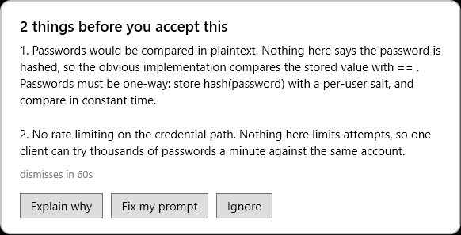

# Proof — slice 1

Environment: Windows 11 Home Single Language, Windows PowerShell 5.1.26100.9711,
Bun 1.4.4, Node v22.23.1. The daemon and the live test run on the same machine.

Three suites, in increasing order of what they need:

| Suite | Needs | Checks |
| --- | --- | --- |
| `bun test` | Node/Bun only | 7 tests, 19 expects |
| `tests/Rules.ps1` | PowerShell only, headless | 38 checks |
| `tests/Run-Minimal.ps1` | Windows desktop, real card, real clipboard | 66 checks |

## 1. Plugin contract (all platforms)

`bun test` in `packages/plugins/code-coach`. No fake daemon, no timers, no
sleeps — the plugin has nothing to race:

```text
7 pass
0 fail
19 expect() calls
Ran 7 tests across 1 file. [288.00ms]
```

The seven tests assert:

- one destructive ask writes exactly one request, with the right `id`, `text`,
  `cwd`, and `sid`, and returns the event **deep-equal** to what it received
- the hook returns without waiting when no daemon exists in the process at all,
  and creates no `res-` or `dec-` file. The bound is a regression tripwire
  (< 1 s), not a latency claim: the old design blocked 1.5 s on a verdict and
  5 s on a card decision, so a return to that shape fails the test. The
  structural proof is the same test's assertion that there is no reply channel
  at all.
- with no `daemon.pid`, no prompt text is written to disk
- with a dead pid, no prompt text is written to disk
- continuations, slash commands, pastes over 4000 chars, system-shaped
  payloads, and `COACH_BYPASS` never write
- an IPC folder that cannot be written fails open instead of throwing
- the prompt text never appears in `plugin.log`

## 2. Rules (headless)

`tests/Rules.ps1` sources `src/Coach.Rules.ps1` and asserts every branch with no
daemon, no window, no clipboard. This is the suite that can run on a CI box:

```text
checks: 38  failed: 0
rules: PASS
```

What it covers:

- **Destructive:** `delete all the logs`, `remove the old cache`, `clear the
  build output`, `delete the users table`, `drop table`, `rm -rf` → card
- **Specific / guarded:** `after committing the current state first`, `dry run
  only`, `reset this file only`, `delete src/app.ts` → silence
- **Sweep despite a file name:** `delete all the .ts files in src` → card
- **Silence:** a summary request, a login bug fix, an unrelated endpoint, empty
  text → silence
- **The design-issue example:** the login/password ask produces exactly two
  findings, the title says `2 things before you accept this`, the body numbers
  both findings, the explain text contains the one-way-function lesson, and the
  three buttons are `explain`, `fix`, `ignore`
- **The fixed prompt:** keeps the original ask, names bcrypt or argon2id, adds
  constant-time comparison, rate limiting, and generic errors, and is not the
  original text
- **Independent suppression:** `bcrypt` alone removes the password finding but
  keeps the rate finding; `rate limited` alone removes the rate finding but
  keeps the password finding; both → silence
- **Singular title:** `add a password reset endpoint` → `1 thing before you
  accept this`
- **Precedence:** `delete the password table` → destructive, not security

## 3. Live gate (Windows)



`tests/Run-Minimal.ps1` starts the real daemon in a child process, writes the
same `req-<id>.json` the plugin writes, drives the real WPF card through UI
Automation, clicks every button, and reads the real clipboard. Full output:

```text
[PASS] daemon wrote its pid file
[PASS] daemon process is alive
[PASS] destructive ask shows a card
[PASS] the request is consumed
[PASS] exactly one card
[PASS] destructive card offers Copy the guardrail
[PASS] destructive card offers Dismiss
[PASS] clipboard can be seeded
[PASS] Copy the guardrail clicked
[PASS] clipboard holds the guardrail
[PASS] card closed after the copy
[PASS] benign request is consumed
[PASS] benign ask shows no card
[PASS] guarded request is consumed
[PASS] guarded destructive ask shows no card
[PASS] named-file delete is consumed
[PASS] named-file delete shows no card
[PASS] credential ask shows a card
[PASS] credential request is consumed
[PASS] card title counts two findings
[PASS] card names the plaintext compare
[PASS] card names the missing rate limit
[PASS] card offers Explain why
[PASS] card offers Fix my prompt
[PASS] card offers Ignore
[PASS] Explain why clicked
[PASS] card shows the teaching text
[PASS] explain view offers Back
[PASS] explain view still offers Fix my prompt
[PASS] Back clicked
[PASS] card returns to the findings
[PASS] findings view offers Explain why again
[PASS] clipboard can be re-seeded
[PASS] Fix my prompt clicked
[PASS] clipboard holds a rewritten ask
[PASS] rewrite names bcrypt or argon2id
[PASS] rewrite adds constant-time compare
[PASS] rewrite adds rate limiting
[PASS] rewrite adds generic errors
[PASS] rewrite is not the original
[PASS] card closed after Fix my prompt
[PASS] second credential ask shows a card
[PASS] clipboard can be seeded again
[PASS] Ignore clicked
[PASS] card closed after Ignore
[PASS] Ignore left the clipboard alone
[PASS] card is up before the second ask
[PASS] second request is consumed
[PASS] still exactly one card
[PASS] card closes after the drop
[PASS] stale request is consumed
[PASS] stale request shows no card
[PASS] guard: second daemon exits 2
[PASS] guard: second daemon names the running pid
[PASS] no request files left behind
[PASS] no prompt text in daemon.log or trace.jsonl
[PASS] trace records a destructive card
[PASS] trace records a security card
[PASS] trace records explain
[PASS] trace records back
[PASS] trace records fix
[PASS] trace records the dropped second card
[PASS] trace records the stale request
[PASS] trace records silence
[PASS] stop: daemon exits on the stop file
[PASS] stop: pid file removed

checks: 66  failed: 0
minimal gate: PASS
```

What it proves, in the developer's terms:

- a destructive ask with no recovery point puts exactly one card on screen, and
  **Copy the guardrail** replaces the clipboard with the guardrail
- a credential ask produces the card from the design example: the title counts
  two findings, the body names both, and all three buttons exist
- **Explain why** swaps the card to the teaching text in the same window,
  **Back** returns to the findings, and the findings view is interactive again
- **Fix my prompt** replaces the clipboard with a rewritten ask that names
  bcrypt/argon2id, constant time, rate limiting, and generic errors — and that
  differs from the original
- **Ignore** closes the card and leaves the clipboard exactly as it was
- a benign ask, a guarded destructive ask, and a named-file delete show no card
- a second card-worthy ask while a card is up is dropped, not stacked
- a request older than 120 s is dropped without a card
- no prompt text appears in `daemon.log` or `trace.jsonl`; the trace records
  kinds and actions only
- a second daemon on the same folder exits 2 and names the running pid
- the stop file shuts the daemon down and removes the pid file

## 4. Types, lint, and parse

```text
bun run typecheck:tsc                 exit 0, no diagnostics
oxlint packages/plugins/code-coach    0 warnings, 0 errors (2 files)
PowerShell parse                      4 files, 0 errors
```

The root `bun run typecheck` (`bun turbo typecheck`) could not run in this
sandbox: the script shells out to a global `bun` binary that is not on PATH
here. The package's own `tsc --noEmit` is the check that covers the two changed
TypeScript files, and it is clean.

## 5. Bugs this work caught

**The hook was a pre-send gate.** The first revision polled for a verdict
(1.5 s) and then for a card decision (5 s) inside `session.hook("prompt")`.
opencode core awaits that hook inside `SessionPrompt.prepare`, before the
message is admitted, so the "post-send" coach was actually delaying every send
that matched. The upstream review caught it; the fix is structural — the hook
now does one file write and returns, and there is no channel back to the plugin
at all.

**The plugin never created its log directory.** If the plugin loaded before the
daemon had ever run, `appendFileSync` failed silently and the plugin produced no
log at all. The log-directory test caught it; setup now creates `logs\` next to
`ipc\`.

**The guard regex missed a real recovery point.** `after committing the current
state first` did not match, because the pattern only knew `commit first` and
`commit before`. The rule test failed; the pattern is now
`commit\w*\s+(?:first|before|the current)`.

**A named-file delete fired as a sweep.** `delete src/app.ts` matched the verb
and the object (`files` is not required — `delete` plus a path was enough), so a
specific one-target ask got a card. The rule test failed; a single named file is
now treated as specific, while `delete all the .ts files` still fires.

**A PowerShell `.Count` trap made correct code look broken.** After
`Where-Object`, a single match is a hashtable, and `.Count` on a hashtable is its
key count (3), not 1. Three rule checks failed for that reason alone. The tests
now wrap the pipeline in `@()`, which is the correct PowerShell idiom and the
same trap the daemon avoids when it collects requests.

## 6. Scope

This receipt covers two deterministic rules and two card shapes: a destructive
nudge with a guardrail copy, and a credential nudge with Explain why, Fix my
prompt, and Ignore. It does not claim the model-backed triage lane, the learner
profile, snooze, the project layer, autostart, the doctor, or any editor lane
other than the opencode plugin. Those are later slices and are listed in the
README.
