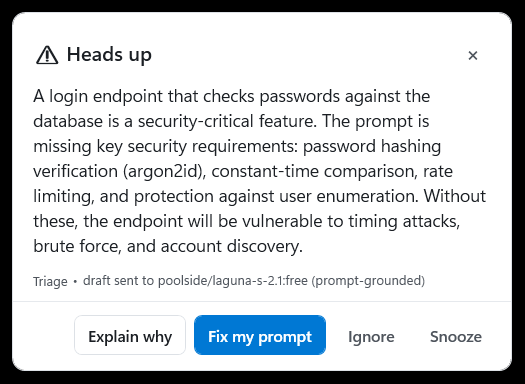
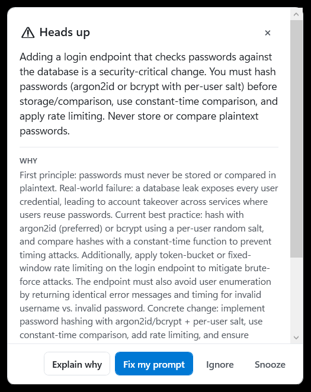
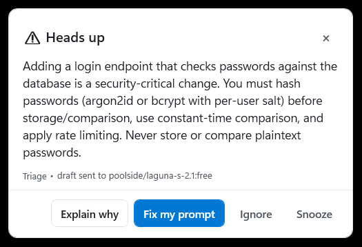

# Proof

- Windows 11, Windows PowerShell 5.1, opencode v2.1.4
- Daemon under test: the same `src/` tree that is in this package (all 16 files
  are byte-identical to the tested tree, and so is `tests/Prove-CodeCoach.ps1`)
- Lane: OpenAI-compatible HTTP, `https://openrouter.ai/api/v1`,
  model `poolside/laguna-s-2.1:free`, key from `OPENROUTER_API_KEY`

Paths below are shortened to `C:\Users\me`; everything else is verbatim output.

## Live proof

`tests\Prove-CodeCoach.ps1` drives the real daemon over the same `req/res/dec`
files the plugin writes. It refuses to run unless the daemon wrote
`state_restored` at boot, so it cannot measure yesterday's binary. Result:
**24 pass, 0 warn, 0 fail**.

| Row | Sent / clicked | What the trace and window showed |
|---|---|---|
| A | destructive ask, no file | `action=attach attachment_len=109`; attachment does not echo the draft; no nudge |
| L0 | `Add a login endpoint that checks the user's password against the database` | `triage_security facts=0` -> `triage_started`; this run's answer invented `hmac.c` and was dropped as `triage_ungrounded` |
| L | same login ask, naming `src/Coach.Gate.ps1` | `triage_card tags=password-hashing,... grounding=facts` -> card -> **Explain why** -> **Fix my prompt** copied a 355-char rewrite |
| C | clean refactor naming a briefed file | `triage_started` -> `triage_silent`, no card |
| S | grounded login ask -> **Snooze** | `card_snoozed minutes=120`; `state.json` deadline in the future |

Key lines from the run:

```json
{"ev":"triage_security","facts":0}
{"ev":"triage_started","len":3887}
{"ev":"triage_ungrounded","why":"invented-file","detail":"hmac.c"}
{"ev":"triage_card","tags":"password-hashing,constant-time-comparison,rate-limiting,user-enumeration","grounding":"facts","severity":"critical"}
{"ev":"card_shown","kind":"nudge","hwnd":2822654}
{"ev":"triage_silent"}
{"ev":"card_snoozed","minutes":120}
```

The nudge, verbatim:

> Adding a login endpoint that checks passwords against the database is a
> security-critical change. You must hash passwords (argon2id or bcrypt with
> per-user salt) before storage/comparison, use constant-time comparison, and
> apply rate limiting. Never store or compare plaintext passwords.

**Fix my prompt** put this on the clipboard (length 355). The receipt requires
both a hashing mechanism and a rate-limit mechanism:

```text
Add a login endpoint in src/Coach.Gate.ps1 that authenticates users by hashing
the submitted password with argon2id (or bcrypt) using a per-user salt,
compares the hash using a constant-time function, applies token-bucket rate
limiting, and returns identical error messages and timing for invalid username
vs. invalid password to prevent user enumeration.
```

## The card

No-file login ask, prompt-grounded variant. The footer names the model that
judged the draft:



Grounded login ask, after **Explain why**:



The grounded nudge before the click:



## 612-check suite

The daemon's development harness runs each runner in its own process with a
hard deadline. The receipt below is from the same `src/` tree; the suite itself
is not shipped in this plugin package.

```text
Runner              Result                                      Time
------              ------                                      ----
check-parse         PASS    check-parse: 45 files, 0 with errors    0.4s
Analyzer            PASS    RESULT 71 passed, 0 failed             14.2s
Card                PASS    RESULT 42 passed, 0 failed              1.5s
Code                PASS    RESULT 53 passed, 0 failed              1.6s
CodeCard            PASS    RESULT 11 passed, 0 failed             15.3s
Core                PASS    RESULT 101 passed, 0 failed             1.3s
Daemon              PASS    RESULT 114 passed, 0 failed           162.1s
Focus               PASS    RESULT 27 passed, 0 failed              4.1s
Gate                PASS    RESULT 24 passed, 0 failed              1.3s
Guard               PASS    RESULT 6 passed, 0 failed               9.6s
Learner             PASS    RESULT 35 passed, 0 failed              1.1s
Surfaces            PASS    RESULT 24 passed, 0 failed              1.5s
Triage              PASS    RESULT Run-Triage: pass=63 fail=0       2.4s
Unit                PASS    RESULT 15 passed, 0 failed              1.4s
plugin              PASS    # pass 26 # fail 0                     4.2s

TOTAL 15 runners, 15 passed, 0 failed
```

That is 612 checks across 14 runners (13 PowerShell, 1 Node), plus the 45-file
parse gate.

## Doctor

`tools\Coach-Doctor.ps1` checks the live daemon, the logon guard, the plugin
registration, the IPC folder, the configured lane, the analyzer cache, and the
most recent card. The final run, on the same daemon the proof used:

```text
Code Coach doctor  -  2026-10-27 10:51:27
data dir: C:\Users\me\AppData\Local\CodeCoachData

[OK] daemon alive: pid 22584, up 505 min
[OK] logon guard installed: HKCU Run\CodeCoach points at coach-guard.ps1
[OK] opencode plugin present in the auto-load tree: C:\Users\me\.config\opencode\plugin\code-coach\index.js
[OK] plugin gated a prompt 23 min ago (len 158) - it is live and watching
[OK] ipc folder writable (probe round-tripped)
[OK] promptMode: autosend  (autosend = weaker drafts get context attached silently; review = cards pre-send; off = prompt lane off)
[OK] registered root exists: C:\Users\me\Projects
[OK] triage lane: your own provider https://openrouter.ai/api/v1 -> poolside/laguna-s-2.1:free, env var OPENROUTER_API_KEY is set
[OK] interruption budget: max 6 prompt-cards/hour, triage max 6/hour, snooze buys 120 min
[OK] analyzer briefs: cache written 8h ago, content-keyed, TTL 168h (current)
[OK] most recent card: kind=code, 500 min ago

doctor verdict: GO (0 warn, 0 fail)
```

That run used the development layout, where the plugin sits in the auto-load
tree. The Git-install layout is the other branch of the same check; a sandbox
home containing only a `plugins` entry printed:

```text
[OK] opencode plugin registered in global config: git+https://github.com/anomalyco/opencode.git#path:packages/plugins/code-coach
```

## Install guard

`scripts\install-autostart.ps1` refuses to register a second checkout, because
two guards would run two daemons and card every send twice. Run from a second
checkout while the first is live:

```text
refused: HKCU Run\CodeCoach already points at another checkout: powershell.exe -NoProfile -NonInteractive -STA -WindowStyle Hidden -ExecutionPolicy Bypass -File "C:\Users\me\Projects\code-coach\scripts\coach-guard.ps1" -Root "C:\Users\me\Projects\code-coach"
run scripts\uninstall.ps1 there first, or pass -Force to replace it.
```

Exit code 4, registry unchanged. `-Force` replaces the entry.

## Caveats

- **The free model is not deterministic.** On the no-file login draft it
  sometimes invents a path (`hmac.c`) and the grounding gate drops the card
  with `triage_ungrounded`. That is the gate working, not a pass being faked.
  In this run the no-file answer was dropped exactly that way; the no-file
  screenshot is from an earlier run of the same build where the model stayed on
  the prompt. The required Explain/Fix/Snooze rows use a draft that names a real
  file, so the model has facts to ground on.
- **The provider can rate-limit.** The lane retries up to three times on
  `rate-limited`/`network`/`timeout`; a provider outage is not a product pass.
- **Surface coverage is opt-in.** The wired lane is the opencode plugin. The UI
  Automation watcher for terminals and IDE chat panels is off by default
  (`watchSurfaces=false`); Claude desktop is not a supported surface.
- **Snooze is persisted, not immortal.** `state.json` holds the deadline and
  boot restores it. Deleting the data folder clears it.
- **Auto-hide is a reading window, not a trap.** Nudge 120 s, Explain 180 s,
  code card 45 s, surface card 30 s; hovering freezes the countdown.

## Reproduce

```powershell
# plugin half
bun test

# daemon, foreground
powershell -NoProfile -NonInteractive -STA -ExecutionPolicy Bypass -File src\Coach.Daemon.ps1

# live proof (STA: it builds and reads real WPF cards)
powershell -NoProfile -STA -ExecutionPolicy Bypass -File tests\Prove-CodeCoach.ps1

# environment check
powershell -NoProfile -ExecutionPolicy Bypass -File tools\Coach-Doctor.ps1
```

Set `cardExcludeFromCapture=false` for the proof run: a card hidden from capture
is all black, and the proof refuses to write a blank frame instead of shipping
it as evidence. The data folder is `%LOCALAPPDATA%\CodeCoachData` unless
`COACH_DATA_DIR` says otherwise.
